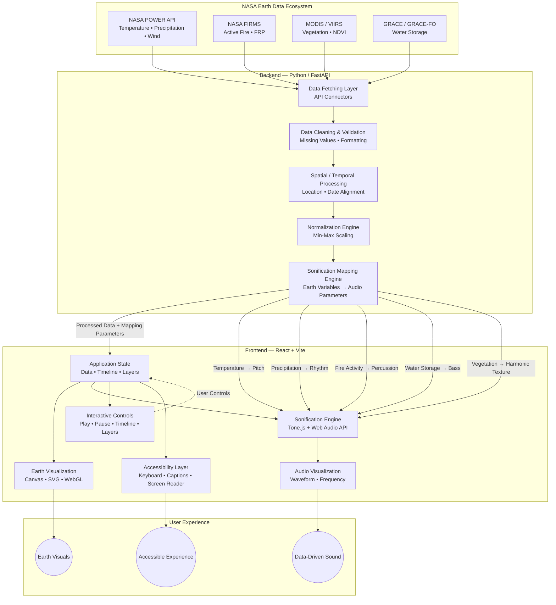

# Prism Tone - *for NASA Space Apps Challenge 2026*

**Challenge:** The Earth Information Jukebox  
**Team:** Cosmic Cloud  
**Project:** Prism Tone

> Prism Tone is an interactive, multimodal sonification system translating NASA Earth science data into real-time audiovisual symphonies.

<br>

[](https://react.dev/)
[](https://vite.dev/)
[](https://tailwindcss.com/)
[](https://motion.dev/)
[](https://tonejs.github.io/)

[](https://www.python.org/)
[](https://fastapi.tiangolo.com/)
[](https://pandas.pydata.org/)
[](https://numpy.org/)

[](https://www.nasa.gov/)
[](#)
[](LICENSE)

## Table of Contents

- [Overview](#overview)
- [Meet the Team](#meet-the-team---cosmic-cloud)
- [Project Status](#project-status)
- [The Idea](#the-idea)
- [Core Concept](#core-concept)
- [Features](#features)
- [Technology Stack](#technology-stack)
- [System Architecture](#system-architecture)
- [Data Sources](#data-sources)
- [User Experience](#user-experience)
- [Planned Experience](#planned-experience)
- [Project Structure](#project-structure)
- [Installation](#installation)
- [Development Roadmap](#development-roadmap)
- [Fail-Safe Development Strategy](#fail-safe-development-strategy)
- [Accessibility Philosophy](#accessibility-philosophy)
- [Future Possibilities](#future-possibilities)

## Overview

The project is an advanced Earth observation platform that solves a critical problem: **Visual-only data often fails to convey the emotional weight of climate change**.

By translating changes in Earth data into meaningful audio parameters, Prism Tone aims to create a more immersive, accessible, and engaging way to understand our changing planet. By utilizing the Web Audio API and a custom FastAPI harmonization engine, Prism Tone acts as an "Earth Jukebox". It ingests multi-decade datasets from 4 distinct NASA sources and dynamically maps climate anomalies (temperature, precipitation, active fires, and water storage) into specific musical parameters. The result is a real-time, data-driven symphony where users can literally ***hear*** the changing planet.

## Meet the Team - Cosmic Cloud

- **Anika Binta Azad Shifa** - *Project Lead (UI/UX Design | Frontend Engineering)*

- **Senjuti Humyra** - *Backend & ML Engineer (Backend Architecture | API Engineering | ML Integration)*

- **Tousif Tasrik** - *System Architect & AI Engineer (System Architecture | Backend Engineering | AI Integration)*

- **Samiha Tasnim Mim** - *Data Scientist & Sonification Specialist (Data Science & Analytics | Signal Mapping | Sonification)*

- **Abu Saleh Md Nahian** - *CG & VFX ARTIST (Animation | Motion Graphics | UI Visuals)*

## Project Status

**Status: In Development**

The repository currently contains the project's initial architecture, interface direction, sonification concept, and development foundation.

Some features described below are part of the planned implementation and may evolve during development.

## The Idea

Earth is constantly changing.

Temperature rises and falls.  
Wind patterns shift.  
Rainfall changes.  
Wildfires emerge and disappear.  
Ice and water storage fluctuate.

These changes are represented through numbers, maps, graphs, and satellite visualizations.

**Prism Tone explores what happens when those same changes become sound.**

For example:

```text
Earth Data
    ↓
Data Processing
    ↓
Normalization
    ↓
Sonification Mapping
    ↓
Audio Parameters
    ↓
Sound
````

## Core Concept

The system maps measurable changes in Earth data to specific sonic parameters. Each layer represents a different environmental phenomenon, creating a structured sonic representation of the planet.

| Audio Layer | NASA Source | Scientific Variable | Sonification Mapping Logic|
|-------------|-------------|---------------------|---------------------------|
| **Melody & Pitch** | NASA POWER | `T2M`  Temperature | Temperature values are normalized and mapped to pitch. Linear temperature maps to exponential frequency (220Hz - 880Hz). Higher temps = rising, tense pitch; creating a rising melodic layer. |
| **Arpeggiator / Rhythm** | NASA POWER | `PRECTOTCORR`  Precipitation | Daily precipitation maps to note density. Lower rainfall produces sparse patterns, while heavier rainfall creates denser rhythms. |
| **Percussion** | NASA FIRMS | Active Fire / FRP | Fire activity controls percussive events. Sudden spikes in FRP trigger erratic, loud drum sequences. |
| **Sub-Bass** | GRACE / GRACE-FO | Terrestrial Water Storage Anomaly | Water-storage changes influence a low-frequency bass layer, allowing long-term variations to be perceived through deeper sonic movement. |
| **Sustained Pad** | MODIS / VIIRS | `NDVI`  Vegetation | Vegetation conditions influence harmonic texture. Healthy vegetation generates lush, rich chords. Deforestation thins the sound to a hollow synth tone. |

### Data-to-Sound Pipeline

```text
NASA Earth Data
      ↓
Data Cleaning & Processing
      ↓
Normalization
      ↓
Sonification Mapping
      ↓
Audio Parameters
      ↓
Dynamic Sound
```

The exact mapping functions will be refined during development and testing to maintain *both scientific interpretability and meaningful listening experiences*.

## Features

### 1. Earth Data Sonification

Transform selected Earth science variables into dynamic sound parameters.

The goal is to make changes in data perceptible through listening.

### 2. Multimodal Experience

Prism Tone combines:

* Earth visualizations
* Scientific data
* Animated data representations
* Real-time or dynamically generated sound
* Audio waveform / frequency visualization
* Timeline-based exploration

This creates a connection between: **What we see → What the data says → What we hear**

### 3. Data-to-Sound Mapping

A transparent mapping layer connects scientific variables to sound properties.

Example:

```text
Temperature
     ↓
Normalization
     ↓
Pitch Mapping
     ↓
Sound Frequency
```

The mapping rules are designed to remain understandable.

### 4. Time-Based Exploration

Users will be able to explore changes across a selected time range.

A timeline-based experience can reveal how Earth conditions evolve and how those changes affect the resulting sonification.

### 5. Data Layer Exploration

Different Earth phenomena can be explored independently or together.

Potential layers include:

* Temperature
* Wind
* Precipitation
* Wildfires
* Ice
* Water Storage
* Vegetation

### 6. Accessibility

Sonification can provide an additional way of experiencing scientific information.

Prism Tone is designed with accessibility in mind, including:

* Keyboard-accessible interaction
* Clear text labels
* Audio descriptions / captions where appropriate
* High-contrast visual design
* Alternative ways to understand important data changes

Accessibility features will be validated as the product develops.

## Technology Stack

### Frontend - Experience, Audio & Visualization

- **React + Vite** - Component-based frontend architecture and fast development
- **Tailwind CSS** - Responsive and utility-first interface styling
- **Motion for React** - Smooth transitions, scroll-based interactions, and cinematic animations
- **Tone.js & Web Audio API** - Dynamic, data-driven sound synthesis and audio control
- **HTML5 Canvas / SVG** - Lightweight scientific visualizations and animated data graphics
- **WebGL / Spline** - Optional immersive 3D and Earth visualizations

### Backend - Data Processing & APIs

- **Python 3.10+** - Core data-processing language
- **FastAPI** - Lightweight, high-performance API layer
- **Pandas** - Data cleaning, transformation, and time-series processing
- **NumPy** - Numerical operations and normalization
- **Uvicorn** - ASGI server for the FastAPI backend

### NASA Data Ecosystem

- **NASA POWER API** - Temperature, precipitation, wind, and other climate parameters
- **NASA FIRMS** - Active fire locations and Fire Radiative Power (FRP)
- **MODIS / VIIRS** - Vegetation and Earth observation data, including NDVI
- **GRACE / GRACE-FO** - Terrestrial water storage and water-storage anomalies

### Development & Reliability

- **Git & GitHub** - Version control and collaborative development
- **Cached / Local Data Fallbacks** - Backup datasets for reliable hackathon demonstrations
- **Modular Architecture** - Keeps visualization, data processing, and sonification components independently maintainable

## System Architecture



### Architecture Flow

```text
  NASA Earth Data
        ↓
  Data Fetching
        ↓
  Cleaning & Validation
        ↓
  Spatial / Temporal Processing
        ↓
  Normalization
        ↓
  Sonification Mapping
        ↓
  React Application State
        ↓
 ┌───────────────┬────────────────┐
 ↓               ↓                ↓
Visualization   Sonification     Accessibility
 ↓               ↓                ↓
Earth Visuals   Data-Driven      Accessible
                Sound            Experience
```

## Data Sources

The project is designed to work with publicly available NASA Earth science datasets and APIs.

Potential sources include:

### NASA POWER

Climate and meteorological data such as:

* Temperature
* Precipitation
* Wind
* Solar-related parameters

### NASA FIRMS

Active fire information and fire-related measurements.

### NASA Earthdata

Earth observation datasets and scientific resources.

### GRACE / GRACE-FO

Terrestrial water storage and related measurements.

### VIIRS & NDVI

Earth observation data that can support vegetation, land, fire, and environmental analysis.

> Final datasets and variables will be selected based on availability, relevance to the challenge, data quality, and implementation feasibility.

## User Experience

The planned experience follows a simple journey:

```text
Explore Earth
     ↓
Choose a Phenomenon
     ↓
View the Data
     ↓
Listen to the Sonification
     ↓
Explore Changes Over Time
     ↓
Understand the Relationship
```

The interface will prioritize storytelling and discovery.

## Planned Experience

### 01 - Discover

An immersive introduction to Earth and its changing systems.

### 02 - Explore

Browse different Earth phenomena such as temperature, wind, rainfall, fire, and ice.

### 03 - Understand

See how scientific data is processed and mapped to sound.

### 04 - Listen

Experience the resulting sonification alongside the corresponding visualization.

### 05 - Compare

Explore how changes in different variables affect the sonic experience.

## Project Structure

The planned repository structure is:

```text
PrismTone/
│
├── frontend/
│   ├── src/
│   │   ├── components/
│   │   ├── sections/
│   │   ├── audio/
│   │   ├── visualization/
│   │   ├── hooks/
│   │   ├── data/
│   │   └── styles/
│   │
│   ├── public/
│   ├── package.json
│   └── vite.config.js
│
├── backend/
│   ├── api/
│   ├── services/
│   ├── core/
│   ├── models/
│   ├── main.py
│   └── requirements.txt
│
├── data/
│   └── sample/
│
├── docs/
│   ├── architecture/
│   ├── sonification/
│   └── research/
│
├── AI_USE.md
├── LICENSE
└── README.md
```

## Installation

> Installation instructions will be finalized as the implementation stabilizes.

### Prerequisites

* Node.js 18+
* Python 3.10+
* Git

### Clone the repository

```bash
git clone https://github.com/Cosmic-Cloud/PrismTone.git
cd PrismTone
```

### Frontend

```bash
cd frontend
npm install
npm run dev
```

### Backend

```bash
cd backend

python -m venv venv
```

Windows:

```bash
venv\Scripts\activate
```

macOS / Linux:

```bash
source venv/bin/activate
```

Then:

```bash
pip install -r requirements.txt
uvicorn main:app --reload
```

## Development Roadmap

### Phase 1 - Foundation

* [x] Project concept
* [x] Sonification concept
* [x] Initial system architecture
* [x] Team roles
* [ ] Frontend foundation
* [ ] Backend foundation

### Phase 2 - Data

* [ ] NASA data integration
* [x] Data cleaning
* [ ] Normalization
* [ ] Time-series processing

### Phase 3 - Sonification

* [ ] Mapping engine
* [ ] Audio synthesis
* [ ] Dynamic parameter control
* [ ] Waveform visualization

### Phase 4 - Experience

* [ ] Earth visualization
* [ ] Interactive timeline
* [ ] Data layer controls
* [ ] Phenomenon exploration

### Phase 5 - Accessibility

* [ ] Keyboard navigation
* [ ] Audio descriptions
* [ ] Captions
* [ ] Accessibility testing

### Phase 6 - Final Polish

* [ ] Performance optimization
* [ ] Responsive design
* [ ] Error handling
* [ ] Offline / cached fallback
* [ ] Final testing
* [ ] Demo preparation

## Fail-Safe Development Strategy

Because Prism Tone is being developed for a time-limited hackathon, reliability is a priority.

The application is designed to maintain a functional experience even if certain advanced visual components fail.

Potential fallback layers include:

```text
Advanced Visualization
        ↓
Canvas / SVG Visualization
        ↓
Static / Animated Earth Visual
        ↓
Core Data + Sonification Experience
```

The central concept of Prism Tone should remain functional even without advanced 3D rendering.

## Accessibility Philosophy

The project explores how sound can provide another pathway into Earth science.

> **Science should have more than one way in.**

Planned accessibility considerations include:

* Keyboard navigation
* Screen-reader-friendly content
* High contrast
* Reduced motion
* Captions
* Descriptive audio
* Clear data labels
* Non-color-dependent information

Accessibility compliance will be evaluated during testing.

## Future Possibilities

Prism Tone can potentially evolve beyond the initial challenge prototype into:

* Real-time Earth data streaming
* More advanced spatial audio
* User-defined sonification mappings
* Multi-variable compositions
* Geographic audio mapping
* Headphone-based spatial experiences
* Educational Earth science experiences
* Expanded NASA dataset support

---

## License

This project is licensed under the **Apache License 2.0**.

See [`LICENSE`](LICENSE) for details.

NASA datasets and resources used by the project remain subject to their respective data-use and attribution requirements.
