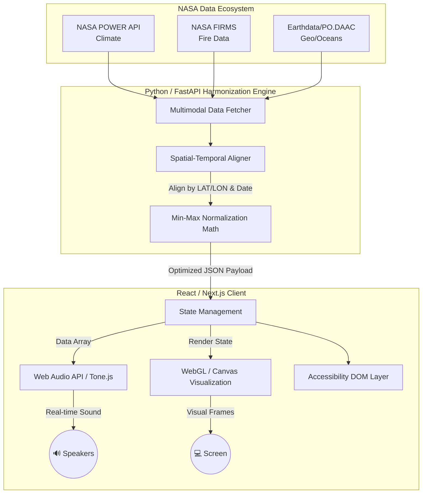

# Prism Tone - The Earth Information Jukebox

> An interactive, multimodal sonification system translating NASA Earth science data into real-time audiovisual symphonies.

<br>

[](https://reactjs.org/)
[](https://tonejs.github.io/)
[](https://www.python.org/)
[](https://fastapi.tiangolo.com/)
[](https://pandas.pydata.org/)
[](https://numpy.org/)
[](#)
[](LICENSE)

## Table of Contents

- [Overview](#-overview)
- [Features](#-features)
- [Technology Stack](#-technology-stack)
- [System Architecture](#-system-architecture)
- [Defensible Mapping Logic](#-defensible-mapping-logic)
- [Installation](#-installation)
- [Usage](#-usage)
- [Project Structure](#-project-structure)
- [Accessibility Protocol](#-accessibility-protocol)
- [Meet the Team](#-meet-the-team)

## Overview

**Prism Tone** is an advanced Earth observation platform that solves a critical problem in science communication: **Visual-only data excludes visually impaired communities and often fails to convey the emotional weight of climate change.**

By utilizing the **Web Audio API** and a custom **FastAPI harmonization engine**, Prism Tone acts as an "Earth Jukebox". It ingests multi-decade datasets from 4 distinct NASA sources and dynamically maps climate anomalies (temperature, precipitation, active fires, and water storage) into specific musical parameters. The result is a real-time, data-driven symphony where users can literally *hear* the changing planet.

## Features

###  Real-Time Parametric Sonification
- **Live Synthesis**: No pre-recorded MP3s. Sound is generated in real-time in the browser using digital oscillators and Tone.js.
- **Multimodal Audio Layers**: Combines melody (temperature), rhythm (precipitation), percussion (wildfires), and sub-bass (water storage).
- **Data-Driven Tension**: Rising global temperatures exponentially increase pitch and harmonic distortion, triggering an emotional response.

### Data Harmonization Engine
-  **Spatial-Temporal Alignment**: Aligns disparate datasets (daily weather vs. monthly vegetation) into a unified playback timeline.

- **Min-Max Normalization Math**: Automatically scales raw values (e.g., Megawatts of fire radiative power) into standardized `0.0` to `1.0` audio mapping float values.

### Absolute Accessibility
- **Described Audio Mode**: Screen-reader optimized layers that verbally announce major climate shifts at year boundaries.
- **Live Text Captions**: Real-time plain English translation of the audio (e.g., *"Intense percussion indicates severe wildfire activity"*).
- **The Screen-Off Guarantee**: The platform delivers its complete scientific narrative even if the user's monitor is entirely turned off.


## Meet the Team (Cosmic Cloud)
-   **Anika Binta Azad Shifa** — _Project Lead (UI/UX Design & Frontend Engineering)_
-   **Sejuti Humyra** — _Backend & ML Engineer (Backend Architecture, API Engineering)_
-   **Samiha Tasnim** — _Data Scientist & Sonification Specialist (Signal Mapping)_
-   **Tousif Tasrik** — _System Architect & AI Engineer (System Architecture, Backend)_
-   **Abu Saleh Md Nahian** — _Visual Experience & Motion Design Engineer (WebGL, VFX)_
    

##  Technology Stack

### Frontend (Audio & Visuals)
- **React 18 / Next.js** - UI Library and framework
- **Tone.js & Web Audio API** - Zero-latency parametric sound synthesis
- **WebGL / HTML5 Canvas** - Dynamic, high-fps visual rendering
- **Tailwind CSS** - Utility-first CSS framework

### Backend (Data Pipeline)
- **Python 3.10+** - Core programming language
- **FastAPI** - High-performance async REST API
- **Pandas / NumPy** - Data harmonization, cleaning, and normalization
- **Uvicorn** - ASGI web server

### Data Sources (NASA Ecosystem)
- **NASA POWER API** - Historical climate data (Temperature, Precipitation, Solar)
- **NASA FIRMS** - Active Fire Hotspots (FRP)
- **MODIS / VIIRS** - Vegetation Health Index (NDVI)
- **GRACE / GRACE-FO** - Terrestrial Water Storage (Groundwater)

## System Architecture

## Defensible Mapping Logic

*"A sonification whose rules are visible is science communication. One whose rules are hidden is a mere sound effect."* 

| Audio Layer | NASA Source | Scientific Variable | Sonification Mapping Logic |
| :--- | :--- | :--- | :--- |
| **Melody & Pitch** | NASA POWER | `T2M` (Temperature) | Linear temperature maps to exponential frequency (220Hz - 880Hz). Higher temps = rising, tense pitch. |
| **Arpeggiator / Rhythm** | NASA POWER | `PRECTOTCORR` (Rainfall) | Daily precipitation maps to note density. Dry spells = slow notes; Heavy rain = rapid rhythms. |
| **Percussion** | NASA FIRMS | Active Fire Counts | Sparse fire events map to percussive hits. Sudden spikes in FRP trigger erratic, loud drum sequences. |
| **Sub-Bass Line** | GRACE-FO | Water Storage Anomaly | Groundwater maps to a deep LFO bass. Depleted water storage results in a fading, unstable bass frequency. |
| **Sustained Pad (Chords)**| MODIS / VIIRS | `NDVI` (Vegetation) | Healthy vegetation generates lush, rich chords. Deforestation thins the sound to a hollow synth tone. |

## Installation

### Prerequisites

-   **Python 3.10+**    
-   **Node.js 18+**

### Step 1: Clone the Repository

```bash
git clone https://github.com/Cosmic-Cloud/PrismTone.git
cd PrismTone
```

### Step 2: Backend Setup

```bash
cd backend
python -m venv venv
source venv/bin/activate  # On Windows use: venv\Scripts\activate
pip install -r requirements.txt
```

### Step 3: Frontend Setup

```bash
cd ../frontend
npm install
```

## Usage

### 1. Start the FastAPI Backend

```bash
cd backend
uvicorn main:app --host 0.0.0.0 --port 8000 --reload
```

_The backend API will be available at `http://localhost:8000`_

  

### 2. Start the React Frontend

```bash
cd frontend
npm run dev
```

_The interactive Jukebox UI will be available at `http://localhost:3000`_


### 3. Generate the Symphony

1.  Open `http://localhost:3000` in your browser.   
2.  Select a geographic location (e.g., Bangladesh) and a time range (1985-2025).
3.  Click **"Play Earth Story"**.
4.  Adjust the mapping toggles to solo specific data layers (e.g., mute temperature to hear only fire events).
    
      
    

## Project Structure


```bash
PrismTone/
│
├── backend/                 # Python FastAPI Server
│   ├── api/                 # REST endpoints
│   ├── core/                # Data normalization math & logic
│   ├── services/            # NASA API fetchers (POWER, FIRMS)
│   ├── main.py                 # FastAPI entry point
│   └── requirements.txt        # Python dependencies
│
├── frontend/                # Next.js / React Application
│   ├── src/
│   │   ├── audio/           # Tone.js synthesis engine
│   │   ├── components/      # UI components (Map, Player controls)
│   │   ├── hooks/           # Custom React hooks for data sync
│   │   └── styles/          # Tailwind CSS
│   ├── package.json
│   └── next.config.js
│
├── data_cache/             # Offline JSON payloads for Hackathon safety
├── 📄 AI_USE.md           # Transparent AI usage disclosure
├── 📄 LICENSE
└── 📄 README.md
```

##  Accessibility Protocol

Accessibility is the core metric of Prism Tone. Our UI ensures:

-   **WCAG 2.1 AA Compliance** for all text contrast ratios.
-   **Colorblind-Safe Palettes** (Viridis/Cividis) for the WebGL visualizer.
-   **Reduced Motion Support**: Respects OS-level `prefers-reduced-motion` queries.      
-   **Keyboard Traversal**: Entire timeline and mapping controls can be navigated via `Tab` and `Enter`.


## Future Enhancements

-   **Spatial Audio (Dolby Atmos)**: Mapping geographic latitude to stereo panning.
-   **Custom Mapping Engine**: Allowing users to drag-and-drop variables to different instruments.
-   **Real-Time Streaming**: Live connections to satellite downlinks for live-updating symphonies.

## License

This project is licensed under the **Apache-2.0 License** - see the [LICENSE](https://www.google.com/search?q=LICENSE&utm_source=gemini) file for details. All NASA datasets are utilized under public domain open-data policies.
